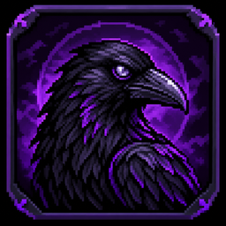
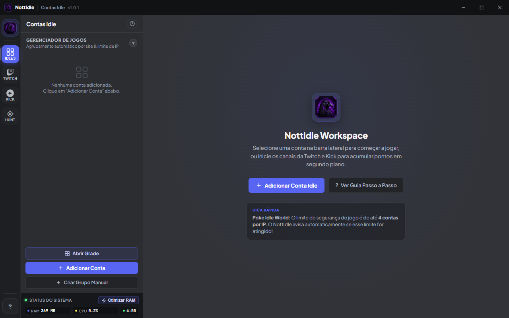
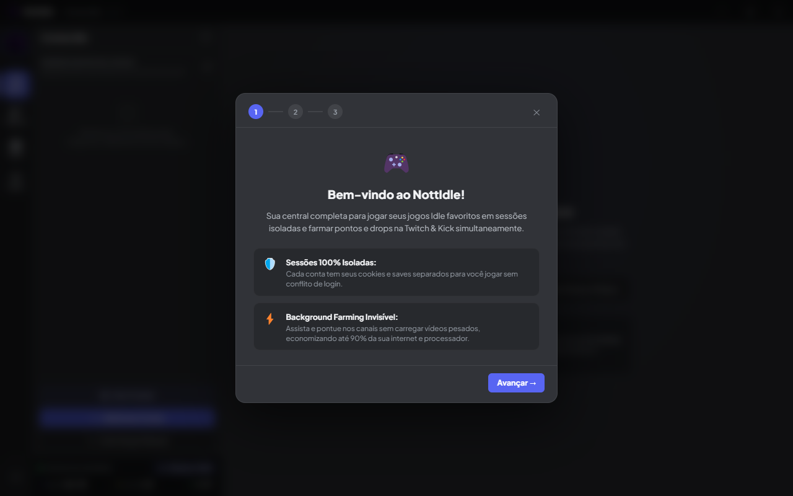

<p align="center">
  
</p>

<h1 align="center">NottIdle</h1>

<p align="center">
  <strong>Suas contas idle, a Twitch e a Kick em um só lugar.</strong>
</p>

<p align="center">
  Gerenciador desktop para Windows que reúne contas de jogos idle em sessões isoladas,<br>
  farm automático de pontos na Twitch e na Kick e a ferramenta <strong>Hunt — Onde caçar?</strong> do PokéIdle.
</p>

<p align="center">
  <a href="https://github.com/VinnyFachiani/NottIdle-Releases/releases/latest">
    
  </a>
</p>

<p align="center">
  
  
  
  
  
</p>

<p align="center">
  <a href="#o-que-é-o-nottidle">O que é</a> ·
  <a href="#recursos">Recursos</a> ·
  <a href="#instalação">Instalação</a> ·
  <a href="#tutorial-de-uso">Tutorial</a> ·
  <a href="#farm-em-segundo-plano">Farm</a> ·
  <a href="#atualizações">Atualizações</a> ·
  <a href="#seus-dados">Seus dados</a> ·
  <a href="#perguntas-frequentes">FAQ</a>
</p>

---

> **Este repositório distribui apenas o app.** O código-fonte é privado. Baixe sempre o instalador mais recente na aba **[Releases](https://github.com/VinnyFachiani/NottIdle-Releases/releases)** ou pelo botão acima.

## O que é o NottIdle?

O **NottIdle** é um hub desktop para quem joga mais de um jogo idle ao mesmo tempo e também quer acumular pontos assistindo canais na **Twitch** e na **Kick** — tudo em uma única janela, sem precisar abrir vários navegadores ou perfis.

Cada conta idle roda em uma **sessão isolada do Chromium**: cookies, login e saves de uma conta não interferem nos das outras. É possível ver várias contas ao mesmo tempo em uma grade, farmar canais em segundo plano e usar a ferramenta **Hunt** para descobrir onde vale mais a pena caçar no PokéIdle.

O app **não modifica os jogos nem os sites**. Ele apenas abre cada página dentro de uma sessão própria, como um navegador separado para cada conta.

<p align="center">
  
  <br>
  <sub>Tela inicial do NottIdle — contas idle, Twitch, Kick e Hunt na mesma janela.</sub>
</p>

## Recursos

| Recurso | O que faz |
|---|---|
| 🗂️ **Contas idle isoladas** | Cada conta tem cookies, login e save separados. Vários jogos, várias contas, sem conflito. |
| 🧩 **Grade multi-conta** | Exiba de 2 a 9 contas ao mesmo tempo, com layouts prontos, divisórias ajustáveis e foco de áudio. |
| 📺 **Farm Twitch** | Assiste canais ao vivo em janelas ocultas, em 160p, com chat conectado e recuperação automática. |
| 🟢 **Farm Kick** | Pontos, recompensas e resgate direto pelo app, com saldo e histórico por canal. |
| 🔑 **Login assistido** | Janela dedicada para entrar na Twitch e na Kick uma única vez; o app detecta a sessão sozinho. |
| 🧱 **Extensões por conta** | Instale extensões da Chrome Web Store na sessão de cada conta ou escolha uma pasta local. |
| 🎯 **Hunt — Onde caçar?** | Simula as hunts do PokéIdle e ranqueia por **XP/h** ou **ouro/h**, com risco de morte. |
| 📊 **Monitor de recursos** | RAM e CPU do app em tempo real, uso por stream e botão **Otimizar RAM**. |
| 🔄 **Atualização automática** | Verifica, baixa e instala novas versões pelo GitHub Releases sem perder o perfil. |
| 🌙 **Tema escuro em pt-BR** | Interface pensada para ficar aberta por horas, com atalhos e ajuda em cada aba. |

### Contas idle com sessões realmente separadas

Cada conta é aberta em uma partição própria (`persist:account-<id>`). Na prática, é como ter um navegador exclusivo para cada conta: você pode estar logado em duas contas do mesmo jogo, com saves e cookies diferentes, sem que uma derrube a outra.

O app reconhece alguns jogos conhecidos e já sugere o grupo e o limite de contas por IP:

| Jogo | Limite por IP |
|---|---|
| PokéIdle / PokéIdle World | **4 contas** |
| Idle Slayer | **1 conta** |
| PokéClicker | sem limite |
| Melvor Idle | sem limite |
| Outros sites | sem limite (usa o domínio como grupo) |

Quando o limite é ultrapassado, o badge do grupo fica vermelho e o app avisa. O limite é um alerta de segurança do próprio jogo — o NottIdle não bloqueia a conta.

### Grade multi-conta

A grade permite acompanhar várias contas de uma vez, com layouts prontos:

`Automático` · `1 tela` · `2 lado a lado` · `2 empilhadas` · `Principal + 2` · `Grade 2×2` · `Principal + 3` · `Principal à esquerda + 3` · `Principal + 4` · `Grade 3×2` · `Grade 3×3`

- Arraste as **divisórias** para redimensionar as colunas e linhas.
- Arraste os **cabeçalhos** para reordenar as contas.
- Clique em uma tela para dar **foco e áudio** a ela; as demais ficam mudas.
- Use **Solo** para abrir aquela conta sozinha, **×** para removê-la da grade e **Tamanhos** para voltar ao layout padrão.
- **Sair** volta ao modo de conta única.

> A grade abre sempre em conta única ao iniciar o app; a ordem das telas é salva, mas o estado “grade aberta” não. Entre 4 e 6 contas é o uso mais confortável — acima de 9 o app usa um layout genérico.

### Farm de Twitch e Kick

O farm roda em **janelas invisíveis de 1280×800**, com vídeo em **160p**, áudio mudo, bloqueio de imagens/fontes e proteção contra throttling. Isso mantém o consumo baixo mesmo com vários canais.

- **Twitch:** mantém o vídeo ativo, fecha banners, clica em “Claim Bonus” e limpa o chat quando ele cresce demais.
- **Kick:** mantém o vídeo ativo, aceita popups de pontos e consulta o saldo periodicamente.
- **Auto-check a cada 5 minutos:** canais ao vivo são conectados automaticamente; canais offline são desconectados para liberar memória.
- **Recuperação de crash:** se a janela de um canal cair, o app recria sozinho, com espera progressiva.
- **Uma sessão por plataforma:** o login da Twitch e o da Kick são compartilhados por todos os canais daquela plataforma. Os pontos vão para a conta logada.

### Pontos e recompensas da Kick

Na aba **Kick**, cada canal mostra o saldo de pontos. Clique no badge para abrir o modal de recompensas: escolha a recompensa, escreva uma mensagem (quando exigido) e resgate. O botão fica bloqueado quando o saldo não é suficiente.

### Extensões do Chrome por conta

No modal de edição da conta você pode:

- **Loja de extensões** — abre a Chrome Web Store em uma janela daquela conta (mesma sessão) e mostra o painel **“Instalar nesta conta”** na página da extensão.
- **Escolher pasta** — carrega uma extensão já descompactada (com `manifest.json`).
- **→** — abre o popup ou a página principal da extensão na sessão da conta.
- **🧩 n** — badge no card da conta com o número de extensões instaladas.

As extensões valem **somente para aquela conta**. Elas não afetam a Twitch, a Kick nem o login das plataformas. Ao adicionar, remover ou atualizar uma extensão, a conta é recarregada — o jogo aberto nela reinicia.

> O Electron suporta um subconjunto das APIs do Chrome. Extensões que dependem de recursos ausentes podem carregar e não funcionar por completo. Instale apenas extensões confiáveis.

### Hunt — Onde caçar?

A aba **Hunt** replica a ferramenta “Onde caçar?” do PokéIdle dentro do NottIdle:

1. No jogo, selecione do **nome do Pokémon** até **“Stats-base da espécie”**, copie e cole no campo.
2. Informe o **nível do treinador**.
3. O motor simula cada hunt e ranqueia os melhores locais por **XP/h** ou **ouro/h**.

Você pode filtrar apenas hunts liberadas, considerar **poção automática** e ver o risco de cada local:

| Indicador | Significado |
|---|---|
| `☠ 1 hit` | Um único golpe passa do HP total — risco de morte. |
| `☠ N/h` | Estimativa de mortes por hora. |
| `⚠ N%` | O pior golpe tira 50% ou mais do HP. |
| `✓ N%` | O pior golpe fica abaixo de 50% do HP. |

A Hunt funciona **offline** e salva ficha, nível e preferências no `localStorage` do app. Ela não considera AoE, TM Elemental (Z-Move), Loot Boost nem a venda de Pokémon capturados. Os dados vêm de um snapshot do jogo (v1.337.0, de 21/10/2026, com 1.031 hunts) e podem ficar desatualizados quando o jogo muda.

### Monitor e Otimizar RAM

No rodapé da barra lateral, o monitor mostra **RAM** e **CPU** do app. Passe o mouse sobre a RAM para ver o consumo e o tempo de cada stream ativa.

O botão **Otimizar RAM** limpa caches, força a coleta de lixo e recarrega as contas abertas. Use quando o app estiver aberto há muitas horas — as contas reiniciam por alguns segundos.

## Instalação

### Requisitos

- **Windows 10 ou 11, 64 bits**
- Cerca de **500 MB livres** em disco
- Internet para instalar, atualizar e farmar
- Não precisa de Node.js, npm ou administrador

### Passo a passo

1. Abra a aba **[Releases](https://github.com/VinnyFachiani/NottIdle-Releases/releases/latest)** e baixe o instalador mais recente: `NottIdle-Setup-1.0.1.exe`.
2. Execute o arquivo baixado.
3. Se o Windows mostrar **“O Windows protegeu o seu PC”**, clique em **Mais informações → Executar assim mesmo**. O instalador ainda não tem assinatura de código, então o SmartScreen exibe “editor desconhecido”. Isso é esperado.
4. Escolha a pasta de instalação (opcional) e conclua. O app é instalado **por usuário**, em `%LOCALAPPDATA%\Programs\NottIdle`, e cria um atalho no Menu Iniciar.
5. Abra o **NottIdle**. Na primeira execução, um assistente de 3 passos apresenta o app, os logins e as dicas principais.

<p align="center">
  
  <br>
  <sub>Assistente de primeiro acesso: três passos para configurar o app e começar.</sub>
</p>

> **Atualizando de uma versão anterior?** Basta instalar por cima ou deixar o auto-update trabalhar. Contas, canais, cookies e extensões são preservados.

> **Vindo do HubIdle, IdleDeck ou DesenvolvimentoHub?** Na primeira execução, se o perfil novo estiver vazio, o NottIdle migra contas, sessões, `localStorage` da Hunt e extensões da instalação antiga. As pastas antigas não são apagadas.

## Tutorial de uso

### 1. Adicione sua primeira conta idle

1. Clique em **+ Adicionar Conta** na barra lateral (ou no botão da tela inicial).
2. Preencha:
   - **Nome** — como você quer identificar a conta.
   - **URL** — o endereço do jogo, com `https://`. Exemplo: `https://pokeidle.io/app`.
   - **Grupo / Categoria** — o app sugere um grupo quando reconhece o jogo.
   - **Cor** — usada para identificar a conta na lista e na grade.
3. Clique em **Salvar**.
4. Clique na conta para abri-la dentro do NottIdle. Faça login no jogo normalmente; aquela sessão ficará salva só para essa conta.

**No card da conta:**

- **↻** recarrega somente aquela conta (equivale a `Ctrl+F5`).
- **⋮** abre o menu com editar, suspender e excluir.
- **Suspender** fecha a página e libera RAM; os dados da conta continuam salvos.
- Arraste o card para reordenar ou use **▲ ▼**.

### 2. Organize as contas em grupos

1. Clique em **+ Criar Grupo Manual**.
2. Dê um nome, escolha uma cor e, se quiser, um **limite de contas por IP**.
3. Arraste as contas para o grupo.
4. O badge do grupo mostra `quantidade/limite` e fica vermelho quando o limite é ultrapassado.

Ao excluir um grupo, as contas dele vão para **Outras Contas** — nenhuma conta é apagada.

### 3. Conecte a Twitch e a Kick

Você precisa de **uma conta em cada plataforma** para acumular pontos.

1. Abra a aba **Twitch** (ou **Kick**) na barra lateral.
2. Clique em **Fazer Login**.
3. Uma janela dedicada abre no site. Faça login normalmente, incluindo 2FA se houver.
4. O app detecta o cookie de sessão e atualiza o status para **logado** automaticamente. Se precisar, use o botão **“✓ Já entrei — fechar”**.
5. Repita para a outra plataforma, se quiser farmar nas duas.

> O login é **por plataforma**, não por conta idle. Todos os canais da Twitch usam a mesma sessão da Twitch; todos os canais da Kick usam a mesma sessão da Kick. Os pontos vão para a conta logada.

Se a sessão expirar, o status volta para **não logado** e os pontos param de contar. Basta entrar de novo.

### 4. Adicione canais e comece o farm

1. Na aba **Twitch** ou **Kick**, digite o **nome do canal** (ex.: `gaules`, não a URL completa) e clique em **+**.
2. Use o **toggle** do canal para ativá-lo.
3. Clique em **Conectar todos ativos** para ligar todos de uma vez.
4. O **ponto verde** indica que o canal está ao vivo; o botão de chat abre o chat popout daquele canal.
5. Deixe o app aberto. O farm roda em janelas ocultas — você pode minimizar o NottIdle e continuar usando o PC.

**O que esperar do auto-check:**

- A cada **5 minutos**, o app verifica quem está ao vivo.
- Canal **ao vivo e desconectado** é conectado automaticamente, mesmo que o toggle esteja desligado.
- Canal **offline e conectado** é desconectado e a janela é fechada para liberar RAM.
- Por isso, desligar um canal no toggle vale **até o próximo ciclo**. Se quiser que ele fique realmente parado, remova o canal ou deixe-o offline.

**Na Kick**, clique no badge de pontos do canal para ver o saldo e resgatar recompensas.

### 5. Abra a grade multi-conta

1. Clique em **Abrir Grade** na barra lateral.
2. Clique em **Contas** para escolher quais contas aparecem e em que ordem.
3. Escolha um **Layout** no seletor (2 lado a lado, 2×2, 3×3 etc.).
4. Arraste as divisórias para ajustar o tamanho e os cabeçalhos para reordenar.
5. Clique em uma tela para dar **foco/áudio** a ela.
6. Use **Solo** para abrir uma conta sozinha, **×** para tirá-la da grade e **Sair** para voltar ao modo normal.

### 6. Instale extensões na conta (opcional)

1. Clique em **⋮ → Editar** na conta (ou no lápis).
2. Em **Extensões do Chrome**, clique em **Loja de extensões**.
3. Na janela da loja, abra a extensão desejada e clique em **Instalar nesta conta** no painel do NottIdle.
4. A conta é recarregada e a extensão passa a valer só nela.
5. Use **→** na lista de extensões (ou o badge **🧩**) para abrir o popup/página da extensão.

Também é possível usar **Escolher pasta** para carregar uma extensão descompactada que você já tenha.

### 7. Use a Hunt para escolher onde caçar

1. Abra a aba **Hunt**.
2. No jogo, copie a ficha do Pokémon (do nome até “Stats-base da espécie”) e cole no campo.
3. Informe o nível do treinador.
4. Escolha ordenar por **XP/h** ou **Ouro/h**.
5. Marque **só liberadas** e **poção automática** conforme a sua situação.
6. Veja o ranking, o risco de cada hunt e navegue pelas páginas de resultados.

A ficha fica salva para a próxima vez. O botão **Limpar** apaga apenas os dados da Hunt, não as contas nem os canais.

### 8. Mantenha o app saudável

- **Deixe aberto** para o farm continuar. Fechar o app encerra as janelas de farm.
- Se ficar muitas horas aberto, use **Otimizar RAM**.
- Se uma conta travar, use **↻** nela em vez de reiniciar tudo.
- Acompanhe RAM/CPU no rodapé e o tempo de cada stream no tooltip da RAM.
- Instale as atualizações quando a pill **“Reiniciar para atualizar”** aparecer.

## Farm em segundo plano

O farm foi feito para ser invisível e leve:

- Janelas ocultas de **1280×800**, sem áudio e com vídeo em **160p**.
- **Bloqueio de imagens e fontes** nas páginas dos canais; mídia, scripts e WebSocket continuam funcionando.
- **Anti-throttling:** o Chromium não desacelera as janelas ocultas.
- **Popups e navegação externa bloqueados:** a janela do canal só pode navegar dentro do domínio da plataforma.
- **Spoof de visibilidade:** a página entende que está visível e em foco.
- **Recuperação de crash:** a janela é recriada com espera de 5 s, 10 s, 20 s, 40 s e 60 s (até 5 quedas em 10 minutos).
- **Auto-check:** a cada 5 minutos, além de uma verificação 1,5 s após abrir o app.

<details>
<summary><strong>Detalhes técnicos dos intervalos</strong></summary>

| Intervalo | Tarefa |
|---|---|
| 3 s | RAM/CPU do app (inclui uso por stream no tooltip) |
| 5 s | Manter vídeo ativo e clicar em bônus (Twitch) |
| 15 s | Limpar chat da Twitch e aceitar popups da Kick |
| 20 s | Status ao vivo dos canais Twitch ativos |
| 30 s | Coleta de lixo (`gc`) nas janelas de farm |
| 45 s | Saldo de pontos da Kick |
| 5 min | Verificação de live e auto-conectar/desconectar |
| 10 min | Coleta de lixo das views e do processo principal |

</details>

> Se um canal ficar preso em captcha ou tela de login, a janela continua existindo, mas pode não contar pontos. O tempo de uptime no tooltip da RAM ajuda a identificar esse caso.

## Atualizações

O NottIdle se atualiza pelo **GitHub Releases**:

1. O app verifica atualizações **20 segundos após abrir** e a cada **6 horas**.
2. Se houver versão nova, ela é baixada **em segundo plano** — o farm continua.
3. A pill no topo mostra **“Baixando N%”** e depois **“Reiniciar para atualizar (vX.Y.Z)”**.
4. Clique na pill para reiniciar e instalar. Se você ignorar, a atualização é aplicada quando fechar o app.
5. O app volta com a versão nova e **preserva contas, canais, cookies e extensões**.

Durante o reinício, o farm para por cerca de **10 a 20 segundos**; depois o auto-check reconecta os canais ao vivo.

**Forçar uma checagem:** clique na versão (`v1.0.1`) no canto superior esquerdo da barra de título.

**Baixar manualmente:** pegue o instalador mais recente na aba Releases e instale por cima. O perfil é mantido.

> O auto-update só funciona no app **instalado pelo instalador NSIS**. Execuções de desenvolvimento e a pasta `win-unpacked` não verificam atualizações.

> O instalador não é assinado digitalmente. Alguns antivírus podem atrasar ou colocar o download em quarentena. O `latest.yml` publicado na release contém o SHA-512 do arquivo, e o download é feito por HTTPS.

## Seus dados

Tudo fica na sua máquina, em `%APPDATA%\NottIdle`:

```text
%APPDATA%\NottIdle\
├── nottidle-data.json        # contas, grupos, canais, grade e preferências
├── nottidle-loginstate.json  # status de login da Twitch e da Kick
├── .migracao-perfil.json     # controle da migração de perfis antigos
├── Partitions\               # cookies, localStorage e saves de cada conta
├── Local Storage\            # ficha e preferências da Hunt
└── extensions\               # extensões baixadas da Chrome Web Store
```

- **O app não envia seus dados para nenhum servidor próprio.** Ele fala com a Twitch, a Kick e o GitHub (atualizações). A Hunt funciona offline.
- **Tokens de login ficam nos cookies** dentro de `Partitions\`; não são gravados no JSON.
- **Atualizar ou desinstalar não apaga o perfil.** O instalador está configurado para preservar `%APPDATA%\NottIdle`.
- O cache de atualização fica em `%LOCALAPPDATA%\nottidle-updater` e pode ser apagado a qualquer momento.

### Backup

Com o app **fechado**, copie a pasta inteira:

```text
%APPDATA%\NottIdle
```

Para salvar só a configuração (sem cookies/saves), basta copiar `nottidle-data.json`. A ficha da Hunt fica em `Local Storage\`, então um backup completo precisa incluir essa pasta.

### Reset

Com o app fechado:

- **Só a configuração:** renomeie ou apague `nottidle-data.json`.
- **Tudo:** renomeie ou apague a pasta `%APPDATA%\NottIdle`.
- Se você veio de uma versão antiga e não quer que a migração repovoe o perfil, apague ou renomeie também `%APPDATA%\DesenvolvimentoHub`, `%APPDATA%\HubIdle` e `%APPDATA%\idledeck`.

## Perguntas frequentes

<details>
<summary><strong>O Windows diz “editor desconhecido”. É vírus?</strong></summary>

Não. O instalador ainda não tem assinatura de código, então o SmartScreen mostra esse aviso. Baixe **somente** deste repositório oficial e clique em **Mais informações → Executar assim mesmo**. Se o seu antivírus colocar o arquivo em quarentena, restaure-o ou instale manualmente pela release.

</details>

<details>
<summary><strong>Não estou ganhando pontos. O que verificar?</strong></summary>

1. O status da plataforma está **logado**?
2. O canal está **ao vivo** (ponto verde)?
3. O canal está com o toggle **ativo** ou foi conectado pelo auto-check?
4. A página do canal não está presa em captcha/login? Veja o uptime no tooltip da RAM.
5. Na Twitch, campanhas de drops exigem conta vinculada e podem ter requisitos próprios.
6. Na Kick, confira o saldo no badge do canal.

</details>

<details>
<summary><strong>Por que um canal desconectou sozinho?</strong></summary>

O auto-check roda a cada 5 minutos. Se o canal ficou offline, o app desconecta e fecha a janela para liberar RAM. Quando ele voltar ao vivo, o app reconecta automaticamente. O toggle manual desliga o canal apenas até o próximo ciclo.

</details>

<details>
<summary><strong>A atualização não aparece.</strong></summary>

- O auto-update só funciona no app **instalado**, não em `npm start` ou `win-unpacked`.
- Clique na versão na barra de título para forçar uma checagem.
- A release precisa ter uma versão **maior** que a instalada.
- Feche e reabra o app: a checagem acontece 20 s após o boot.

</details>

<details>
<summary><strong>O app está consumindo muita RAM.</strong></summary>

Cada conta e cada stream é uma página do Chromium. Entre **4 e 6 contas** é o uso mais confortável; os layouts prontos vão até 9 telas, mas quanto mais contas abertas, maior o consumo. Use **Suspender** nas contas paradas e **Otimizar RAM** depois de muitas horas. Evite deixar canais offline ativos.

</details>

<details>
<summary><strong>Minha extensão não funciona direito.</strong></summary>

O Electron implementa um subconjunto das APIs de extensões do Chrome. Extensões que dependem de APIs ausentes podem carregar sem funcionar. Além disso, o popup abre em uma janela separada, então extensões que consultam a “aba ativa” podem se comportar diferente do Chrome. Remova e adicione de novo para forçar o recarregamento da conta.

</details>

<details>
<summary><strong>Consigo usar várias contas da Twitch ou da Kick ao mesmo tempo?</strong></summary>

Não. O NottIdle usa **uma sessão por plataforma**: uma conta da Twitch e uma da Kick. Vários canais podem ser farmados ao mesmo tempo, mas todos os pontos vão para a conta logada naquela plataforma.

</details>

<details>
<summary><strong>Posso fechar o app e continuar farmando?</strong></summary>

Não. O farm acontece dentro do NottIdle. Você pode **minimizar** o app e usar o PC normalmente, mas fechar o app encerra as janelas de farm.

</details>

<details>
<summary><strong>O NottIdle funciona no Linux ou no macOS?</strong></summary>

A build disponível é apenas para **Windows 10/11 x64**.

</details>

<details>
<summary><strong>Onde estão os saves das minhas contas?</strong></summary>

Em `%APPDATA%\NottIdle\Partitions\`, uma pasta por conta. Não apague essa pasta se quiser manter os saves e logins. Para backup completo, copie `%APPDATA%\NottIdle` com o app fechado.

</details>

<details>
<summary><strong>O código-fonte está disponível?</strong></summary>

Não. Este repositório é público apenas para distribuir instaladores e atualizações. O código-fonte do NottIdle é privado.

</details>

<details>
<summary><strong>Perdi minhas contas depois de atualizar. O que fazer?</strong></summary>

A atualização não apaga o perfil. Verifique se o app está usando `%APPDATA%\NottIdle` e se o `nottidle-data.json` continua lá. Se você renomeou a pasta ou apagou o JSON, restaure o backup. Evite apagar `Partitions\` — é onde ficam cookies e saves.

</details>

## Ficha técnica

| Item | Valor |
|---|---|
| Versão atual | **1.0.1** |
| Plataforma | Windows 10/11 x64 |
| Runtime | Electron 33.4.11 |
| Instalador | NSIS, ~203 MB, instalação por usuário |
| Interface | pt-BR, tema escuro |
| Atualizações | GitHub Releases (`VinnyFachiani/NottIdle-Releases`) |
| Dados | `%APPDATA%\NottIdle` |
| Código-fonte | privado |

## Aviso legal

O **NottIdle** é um projeto independente e **não é afiliado, endossado ou patrocinado** pela Twitch, pela Kick, pelo PokéIdle ou por qualquer outro jogo citado. Todas as marcas pertencem aos seus respectivos donos.

O app automatiza a exibição de canais e o acesso a páginas de jogos. **Automação pode violar os Termos de Serviço das plataformas** e resultar em restrições ou banimento da conta. Use apenas com contas próprias, respeite as regras de cada serviço e os limites dos jogos. O uso é por sua conta e risco, sem garantias de qualquer tipo.

---

<p align="center">
  <sub>NottIdle · feito para uso pessoal · <a href="https://github.com/VinnyFachiani/NottIdle-Releases/releases">Releases</a></sub>
</p>
